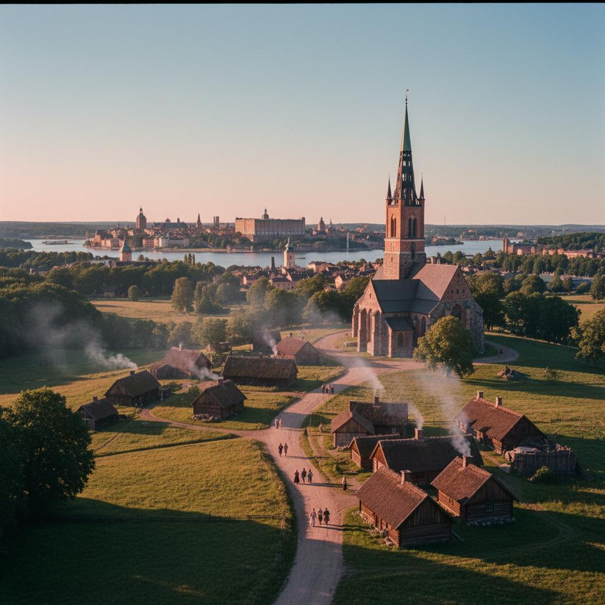
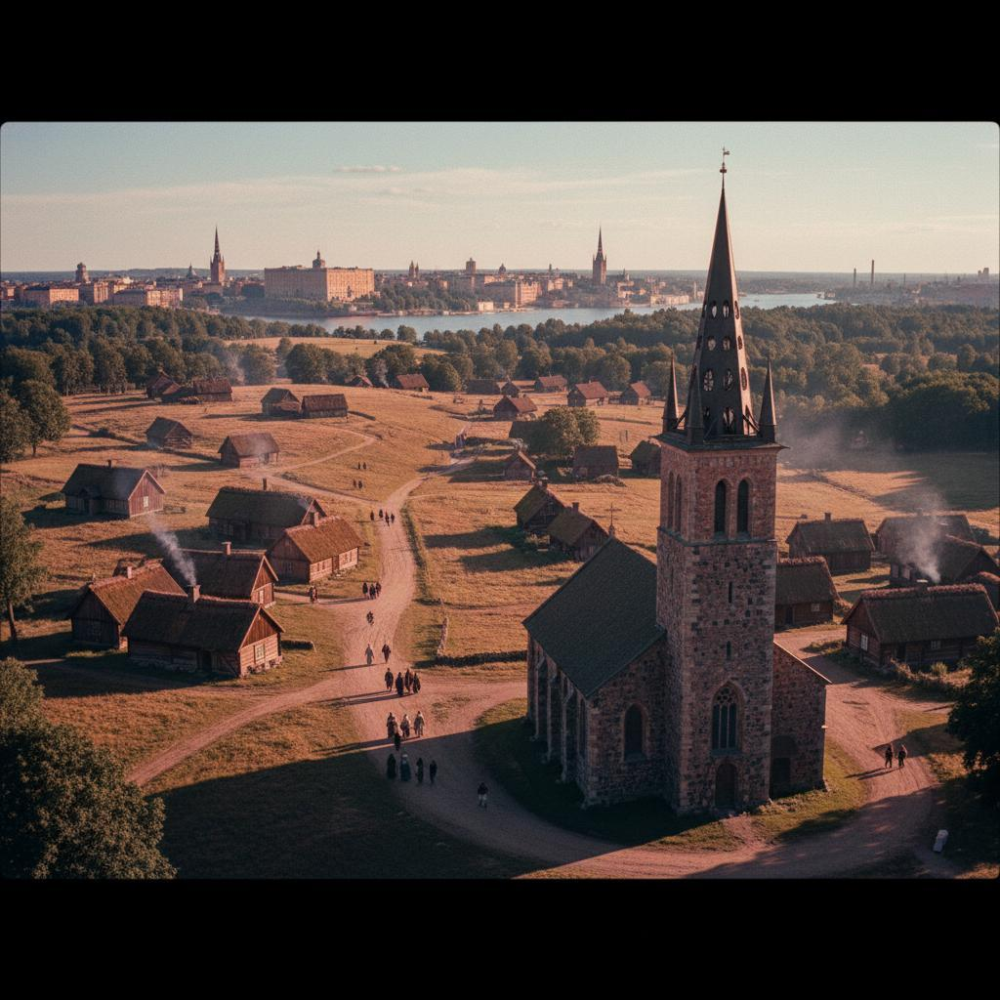
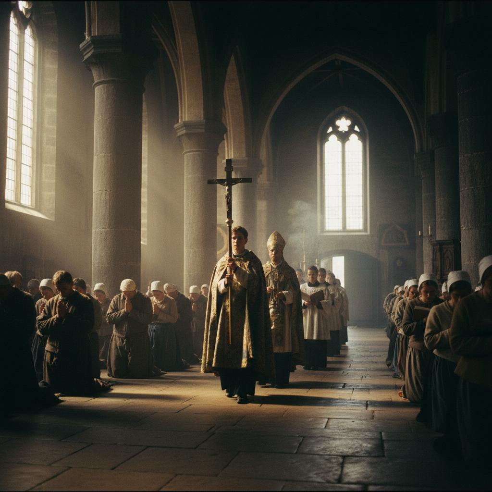
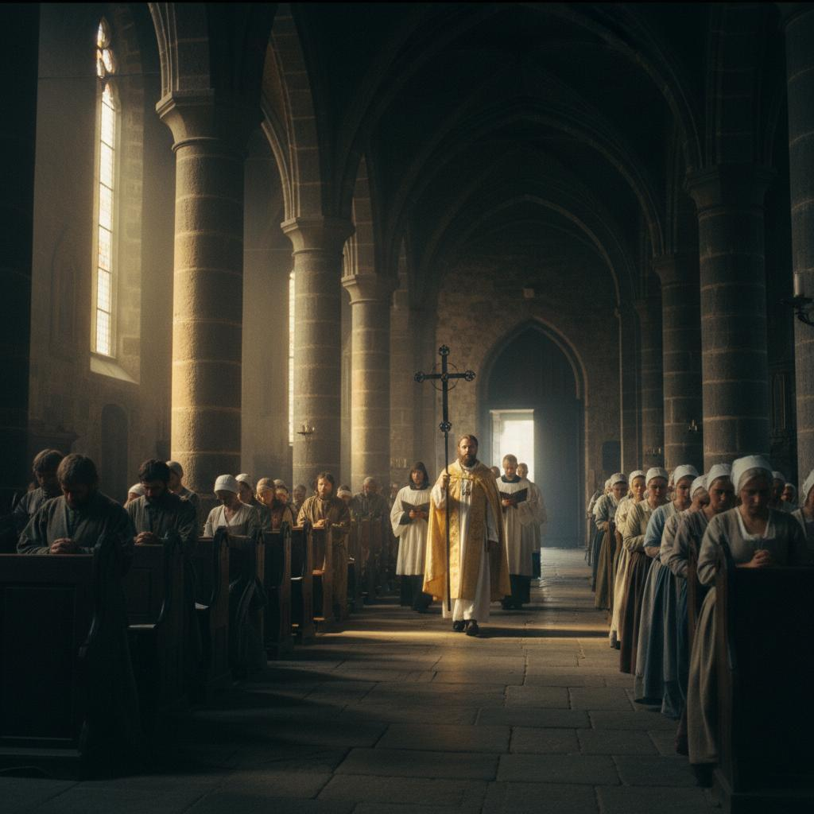
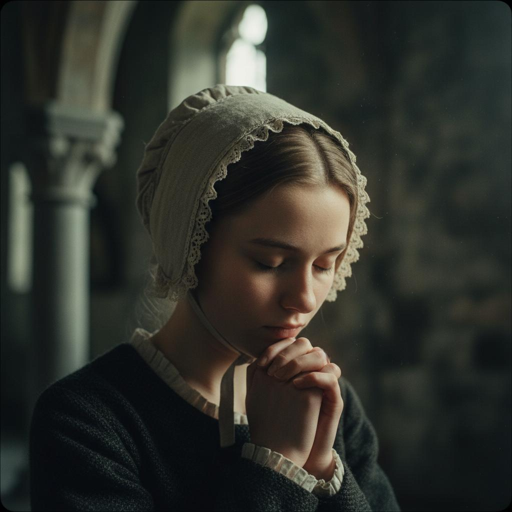
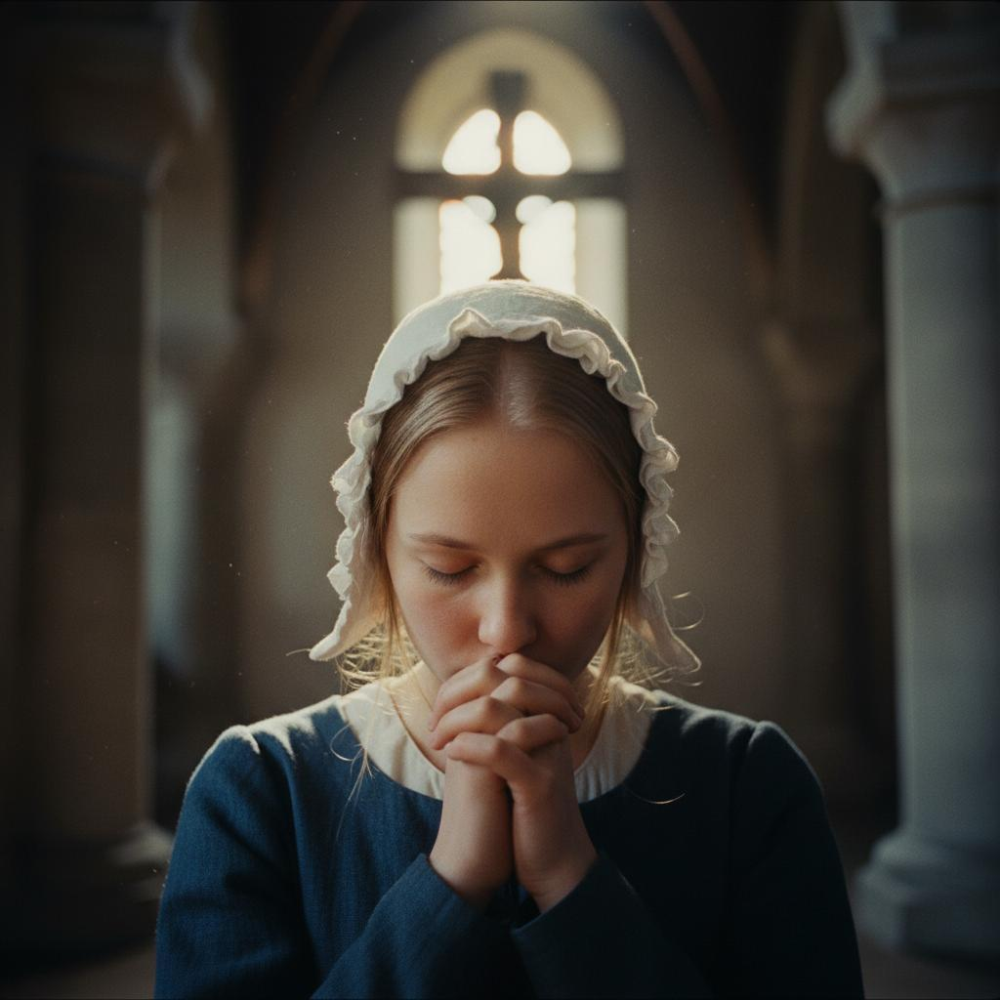

<!--- REVIEW_START -->
# Image Review 250830
---
- **Generated:** [YYMMDD_HHMMSS filled out by Python script]
- **Column 1:** [Generation notes filled out manually by user]
- **Column 2:** [Generation notes filled out manually by user]
- **Total Images:** [filled out by Python script]]
<!--- TOTAL_IMAGES: 1 -->
---
## Shot 1:

| folder1/image1.jpeg           | folder2/image1.jpeg           |
| ----------------------------- | ----------------------------- |
|  |  |

<!--- PROMPT_START -->
**Prompt 1:**
```text
Late 1700s medieval stone church interior, long view down center aisle toward west entrance. Male peasants in period clothing on left pews, female peasants on right, all in prayer. Liturgical procession advancing with crucifer carrying cross, Swedish priest in flowing vestments, deacons and choir members. Sunlight streaming through windows creating golden atmosphere on stone columns.
```

<!--- PROMPT_END -->

<!--- CRITIQUE_START -->
**Critique:**
```text
Too many people and they should be sitting on pews. 
```
<!--- CRITIQUE_END -->
---
## Shot 2:

| folder1/image2.jpeg           | folder2/image2.jpeg           |
| ----------------------------- | ----------------------------- |
|  |  |

<!--- PROMPT_START -->
**Prompt 2:**
```text
Late 1700s medieval stone church interior, long view down center aisle toward west entrance. Male peasants in period clothing on left pews, female peasants on right, all in prayer. Liturgical procession advancing with crucifer carrying cross, Swedish priest in flowing vestments, deacons and choir members. Sunlight streaming through windows creating golden atmosphere on stone columns.
```

<!--- PROMPT_END -->

<!--- CRITIQUE_START -->
**Critique:**
```text
Too many people and they should be sitting on pews. 
```
<!--- CRITIQUE_END -->
---
## Shot 3:

| folder1/image3.jpeg           | folder2/image3.jpeg           |
| ----------------------------- | ----------------------------- |
|  |  |

<!--- PROMPT_START -->
**Prompt 3:**
```text
Late 1700s medieval stone church interior, long view down center aisle toward west entrance. Male peasants in period clothing on left pews, female peasants on right, all in prayer. Liturgical procession advancing with crucifer carrying cross, Swedish priest in flowing vestments, deacons and choir members. Sunlight streaming through windows creating golden atmosphere on stone columns.
```

<!--- PROMPT_END -->

<!--- CRITIQUE_START -->
**Critique:**
```text
Too many people and they should be sitting on pews. 
```
<!--- CRITIQUE_END -->
---

<!--- REVIEW_END -->